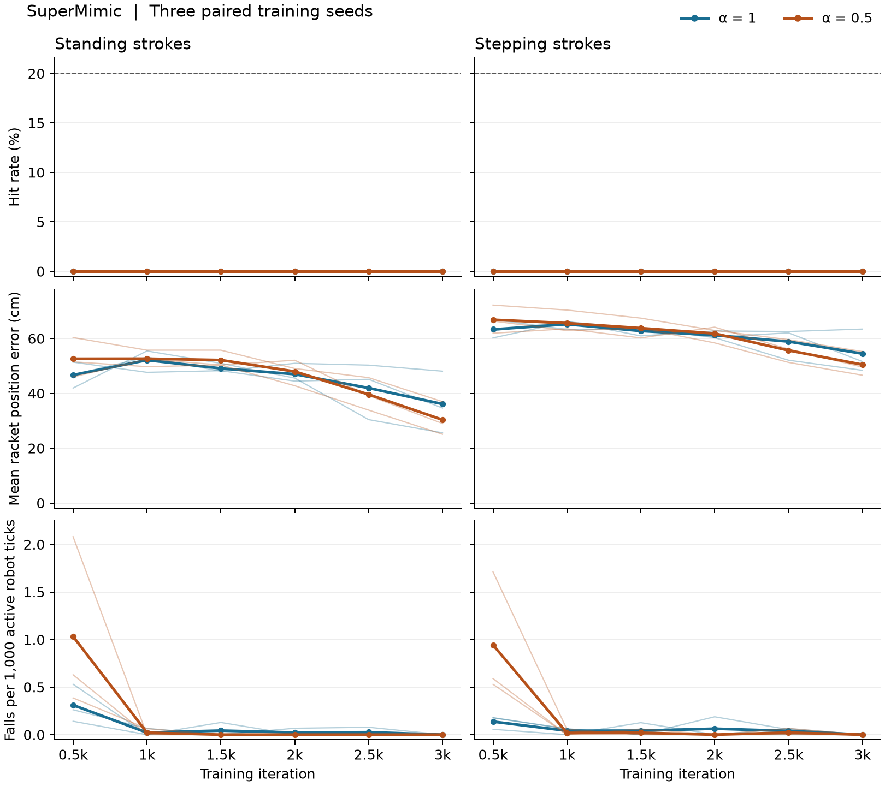

# 2026-11-23 · Paired SuperMimic hitting experiment

Run ID `supermimic_reward_paired_20261123_01` uses branch `experiment/supermimic-reward-split`. The starting tree was clean at `f3b4e809ab084d05b7019b811785c4aa9354086d`. Each run starts from fresh weights. The training code, two MLPs, full-body dynamics and scalar team critic are the ones at that commit.

## Prespecified comparison

Three training seeds (17, 29, 43) each receive both reward weights (1.0 and 0.5). Run order is 1/.5, .5/1, 1/.5. Each arm gets 256 environments, 96 warm-up ticks, 3,000 iterations including 150 dynamics-only iterations, 2,850 actor updates, and 1,944,576 training robot ticks including warm-up. The world model uses 3 batches of 256 with window 8. The policy uses batch 256 and imagined horizon 16. The critic uses 2 epochs and 4 minibatches. Full resolved configs and initial parameter/state digests are retained per arm.

Every 500 iterations, evaluate the EMA policy with held-out seed 12345, 128 environments, 200 warm-up and 500 scored ticks. Use elliptic contact, zero action noise, ordinary sensor noise, no startup handoff and no mid-stroke starts. Each checkpoint gets a fresh evaluator. All six runs continue to the fixed budget regardless of their scores.

- Pool forehand/backhand counts separately within stand and step. A hit requires simultaneous racket position error below 7.5 cm, speed-vector error below 0.5 m/s and face-normal error below 15 degrees at frame 60. The denominator is nonterminated strike ticks. Average Euclidean racket-position error over the same opportunities.
- Charge a fall to the active motion that generated the action immediately before termination. Both startup waiting and interstroke hold have their own exposure bucket. Report falls per 1,000 robot ticks in each bucket. Timeout resets are excluded. Falls use the simulator's reference-relative root-height/tilt criterion.
- Each motion independently qualifies with at least 20% hits on at least 100 strike opportunities at two consecutive checkpoints. Record the first qualifying checkpoint in the pair and its confirmation. Runs with no confirmed pair are censored at the budget. Equal-weight seed means, paired seed differences and the six-point hit-rate curves summarize the comparison. Elapsed wall time is machine-load dependent.
- Source files, the full protocol, all checkpoints, logs and scorer outputs live under `D:/CapstoneTraining/supermimic_reward_paired_20261123_01`. The first six-row protocol was written before the first run. The local wrapper also checks that summed stand/step hit counts and position errors match the standard evaluator and that stand/step/hold recover all falls and ticks.

## Commands

From `hope_training/supermimic_hope` on the Windows GPU host:

```powershell
$py = 'D:/APP/miniconda/envs/isaaclab/python.exe'
$env:HOPE_SUPERMIMIC_DEPS = 'D:/CapstoneTraining/supermimic_fork_deps_py311_20261123'
$env:PYTHONPATH = $env:HOPE_SUPERMIMIC_DEPS
$exp = 'D:/CapstoneTraining/supermimic_reward_paired_20261123_01'
& $py -u "$exp/run_paired.py"
& $py -u "$exp/score_paired.py"
& $py "$exp/analyze.py"
& $py "$exp/plot_curves.py" 'D:/CapstoneTraining/training_plot_deps'
```

`protocol.json` contains every training command. `score_paired.py` scores atomically saved checkpoints and may run concurrently. A repeat needs a fresh evidence directory and the helper scripts present there.

## Results on November 24

All six arms finished at iteration 3,000. All 36 independent checkpoint evaluations passed the count, exposure and checkpoint-budget checks. Within each seed, actor weights, critic weights, dynamics weights, initial observation history and initial simulator state matched across α. The training configurations matched except for α and the run/output identifiers. Each of the 72 motion-by-checkpoint measurements had at least 133 scored strikes. Across all checkpoints there were zero hits in 11,490 opportunities. Neither motion reached the learning criterion for either α on any seed.

| Motion | α | Final hits / strikes | Final position error, seed mean | Final falls / active robot ticks | Falls / 1,000 active ticks pooled over all six checkpoints and three seeds |
|---|---:|---:|---:|---:|---:|
| Stand | 1.0 | 0 / 495 | 36.10 cm | 0 / 48,200 | 0.069 (19 / 277,297) |
| Stand | 0.5 | 0 / 461 | 30.35 cm | 0 / 45,771 | 0.170 (48 / 281,791) |
| Step | 1.0 | 0 / 468 | 54.48 cm | 0 / 47,239 | 0.054 (16 / 296,247) |
| Step | 0.5 | 0 / 491 | 50.47 cm | 0 / 49,168 | 0.174 (51 / 293,012) |

At the final checkpoint, idle/hold falls were 5 / 96,561 robot ticks for α=1 and 4 / 97,061 for α=0.5. Each seed contributes equally to the position-error means. The table pools raw event counts and exposure for the rates. Signed final position-error differences (α=0.5 minus α=1 in cm) for seeds 17, 29 and 43 were −9.56, −11.12, +3.42 standing and −4.99, −8.21, +1.17 stepping. Lower mean final error for α=0.5 did not establish faster learning of the composite hit criterion. The learning-time comparison is censored at 3,000 iterations. The scores apply to the simulator's strike window and a single held-out evaluation seed.

The score collector was also run on the prior 12-iteration checkpoint. Its same-run counters reconciled. Repeating the prior GPU rollout with the same seed scored 48 rather than 45 strikes and 63 rather than 62 falls, so a fixed evaluation seed does not guarantee identical post-reset trajectories.

The protocol, evaluator and reproducibility scripts were archived in commit `863f814bc3464bb71edb8b1045de8d1c58202c5a`. The following results commit records the completed experiment. The archived scripts are in [the evidence directory](evidence/supermimic_reward_paired_20261123_01/). The [108-row CSV](evidence/supermimic_reward_paired_20261123_01/learning_curves.csv) holds both active motions and the waiting bucket. The [full comparison](evidence/supermimic_reward_paired_20261123_01/comparison.json) includes paired effects, initialization and input hashes, and SHA-256 for all 36 checkpoints and their native evaluation JSON files. Hashes refer to the original files on the experiment drive. The recorded GPU was an NVIDIA RTX 5080 Laptop. The separately specified 6,144-environment RTX 4090 run uses a different training budget and configuration.

The thick curves show the three-seed means, the thin curves individual seeds, and the dashed line the 20% hit criterion. The two hit curves overlap throughout the experiment.


